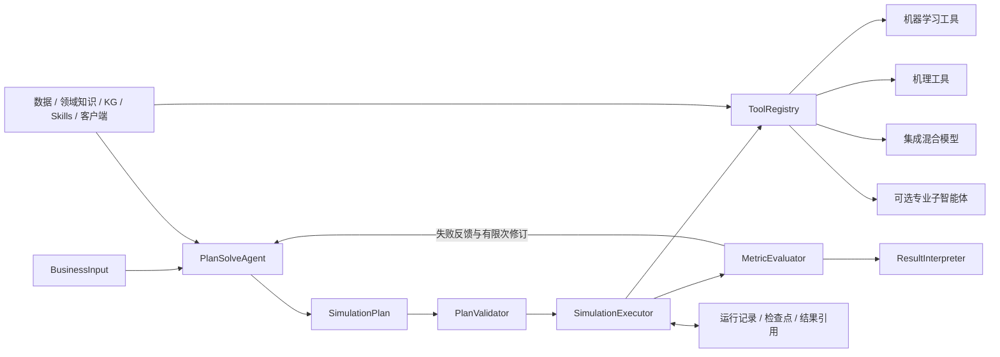

# simAgent

基于 **Pydantic AI slim 2.66.0** 的企业仿真框架，按《补充ppt》的架构实现。
仅包含框架、工具接入和基础设施，不包含业务案例、仿真算法或测试。

业务输入 → PlanSolveAgent → 程序校验 → SimulationExecutor → 程序指标评估 → ResultInterpreter。
执行或验收失败时，可携带结构化反馈返回规划智能体修订。

Python 3.11+；使用 `uv sync` 安装核心依赖。模型供应商和 MCP 按需安装：
`uv sync --extra openai`、`uv sync --extra anthropic`、`uv sync --extra mcp`。
核心安装不附带模型供应商 SDK；导入包不会读取密钥、调用模型或创建数据库。

## 架构与职责

| PPT 组件 | 实现 | 职责 |
| --- | --- | --- |
| 业务输入 | `BusinessInput` | 问题与目标、场景、初态、参数、版本化数据引用、资源和硬约束 |
| 解析与规划智能体 | `PlanSolveAgent` | `Agent(output_type=SimulationPlan)`，通过 `RunContext[PlanningDeps]` 注入依赖；校验失败触发 `ModelRetry` |
| 强类型任务方案 | `SimulationPlan` / `SimulationTask` | 工具映射、依赖、参数来源、单位、资源、运行配置、指标和验收条件 |
| 计划校验 | `PlanValidator` | DAG、接口类型、参数范围、单位、工具版本、资源容量及已注册硬约束 |
| 任务编排与仿真执行 | `SimulationExecutor` | 受控并行、资源准入、作业生命周期、超时重试、取消与恢复 |
| 统一工具接口 | `ModelTool` / `ToolRegistry` | 本地 Python、HTTP、MCP 与 Pydantic AI 子智能体 |
| 程序评估 | `MetricEvaluator` | 确定性计算指标，按阈值验收 |
| 结果解释 | `ResultInterpreter` | 结构化发现、证据引用、收益风险、建议与局限；校验证据引用存在且匹配指标来源 |
| 闭环控制 | `SimulationFramework` | 规划、执行、评估、有限次重规划与解释；持久化修订链 |
| 运行记录与恢复 | `SQLiteRunStore` | 计划、任务状态、job_id、幂等键、版本、seed、结果引用、日志和解释 |

机理工具负责仿真时间、事件队列、对象状态、流程骨架与资源规则。集成混合模型的内部耦合关系
也由工具实现；执行器只编排工具间的数据与作业。资源配额是单次运行中的调度容量，跨运行共享资源
需要由应用或远程作业服务统一管理。

## 接入顺序

1. 定义工具的 Pydantic 参数模型与结果模型，注册到一个 `ToolRegistry`。
2. 创建共享 `PlanValidator`，注册业务硬约束及运行时输入检查。
3. 创建 `Services`，注入数据、知识和现有仿真客户端。
4. 使用模型对象或 Pydantic AI 模型标识创建 `PlanSolveAgent`、`ResultInterpreter`。
5. 创建 `SQLiteRunStore` 和 `SimulationExecutor`，与规划智能体共享同一个 registry 和 validator。
6. 组装 `SimulationFramework`，调用异步 `run(request)`；已有方案可通过 `plan` 参数直接传入。

没有预装业务工具、默认模型、默认密钥或业务规则。注册真实工具并配置模型后才能生成和执行业务方案。
模型供应商 SDK 由对应 extra 安装。`openai_compatible_model` 用于本地或远程兼容端点，
显式接收模型名、`base_url`、可选密钥与 HTTP 客户端；其他供应商可直接传入 Pydantic AI `Model`。

## 公开接口

| 接口 | 含义 |
| --- | --- |
| `PlanSolveAgent.plan(request, previous_plan=..., feedback=...)` | 生成或修订通过程序校验的计划 |
| `PlanValidator.validate(plan, request)` | 同步校验计划；错误以 `PlanValidationError.issues` 返回 |
| `SimulationExecutor.create_run(request, plan)` | 校验并保存运行；返回包含运行 ID 的记录 |
| `SimulationExecutor.execute(run_id)` / `resume(run_id)` | 异步执行或恢复，返回 `RunRecord` |
| `SimulationExecutor.cancel(run_id)` | 异步请求取消；返回确认后的状态 |
| `SimulationExecutor.get_run(run_id)` / `results(run)` | 查询运行和已持久化的成功结果 |
| `SimulationFramework.run(request, plan=...)` | 完整闭环，返回 `WorkflowResult` |
| `SimulationFramework.resume(run_id)` | 沿已保存的修订链找到最新运行，再继续执行、评估和解释 |
| `SQLiteRunStore.events(run_id)` | 获取按顺序保存的运行日志 |

执行器可独立使用，不需要启动 LLM。`WorkflowResult.succeeded` 同时要求工具执行成功与程序验收通过。
`RunState.SUCCEEDED` 仅表示任务执行成功，是否达到业务目标以 `Evaluation.passed` 为准。

## 工具契约

每个 `ModelTool` 声明名称、类型、版本、参数和结果 Pydantic 模型、参数单位、输出单位，
以及是否支持幂等与持久化作业。参数模型字段约束用于范围校验；建议模型配置 `extra="forbid"`。
参数以 Python 字段名绑定，不使用别名。未知参数在计划阶段拒绝，除非参数模型明确允许额外字段。

`ToolInput` 携带 `run_id`、`task_id`、场景、初态、已绑定参数、单位、数据引用、派生 seed 和版本。
`ToolResult` 携带 `payload`、输出单位、外部结果/事件轨迹引用、诊断和版本。
数据引用不由执行器自动解引用；工具通过 `Services.data` 或自己的客户端获取。

统一生命周期：

| 方法 | 返回及约定 |
| --- | --- |
| `submit(input, idempotency_key=...)` | 返回非空 job_id；同一次提交的 key 必须返回同一个作业 |
| `status(job_id)` | `JobUpdate`，状态为 queued / running / succeeded / failed / cancelled |
| `result(job_id)` | 成功作业的 `ToolResult` |
| `cancel(job_id)` | 只有确认作业已停止才返回 `True`，否则返回 `False` |

- `LocalFunctionTool`：包装签名为 `(ToolInput, Services) -> ToolResult` 的同步或异步函数；同步函数在线程中运行。
- `AgentTool`：包装已配置的 Pydantic AI Agent；可通过 `deps_factory` 注入子智能体依赖。
- `HTTPJobTool`：接收应用管理的 `httpx.AsyncClient` 和 `jobs_url`，鉴权和连接生命周期由应用负责。
- `MCPJobTool`：接收已连接的 MCP `ClientSession` 与 `MCPJobMethods`，连接、初始化和关闭由应用负责。

HTTP 接入协议：

| 请求 | 请求体 / 响应 |
| --- | --- |
| `POST {jobs_url}` | 请求体 `ToolInput`；请求头 `Idempotency-Key`；响应 `JobUpdate` |
| `GET {jobs_url}/{job_id}` | 响应 `JobUpdate` |
| `GET {jobs_url}/{job_id}/result` | 响应 `ToolResult` |
| `DELETE {jobs_url}/{job_id}` | 响应 `JobUpdate`；仅终态表示确认停止 |

MCP 的 submit 方法接收 `input` 和 `idempotency_key`，其他三个方法接收 `job_id`。
返回与 HTTP 相同的对象，优先使用 `structuredContent`，也接受单个 JSON 文本块。
这两个适配器要求服务实现持久化作业及提交去重；普通单次请求 API 可由本地异步函数包装，
或者通过继承 `ModelTool` 实现自己的生命周期。

## 绑定、单位、约束与指标

`SimulationTask.parameters` 保存字面参数，`bindings` 将参数名映射到 `ValueReference`，两者不能重名。
引用使用 RFC 6901 JSON Pointer，空字符串表示完整对象，`~0` 和 `~1` 分别表示 `~` 和 `/`。
`source="input"` 指向完整 `BusinessInput`；`source="task"` 指向指定前序任务的 `ToolResult.payload`。
每个任务结果引用都必须显式列入该任务的 `depends_on`。

输入参数单位由 `BusinessInput.parameter_units` 声明，工具参数单位由 descriptor 声明；
工具输出单位以结果 payload 的 JSON Pointer 为键。框架严格比较单位标签，不自动猜测或换算。
前序结果产生后再次验证全部参数及业务输入检查，跨字段 Pydantic 校验器也在此时执行。

`BusinessConstraint` 使用稳定名称和参数。调用 `register_constraint(name, check)` 注册
`(plan, request, constraint) -> list[str]` 检查函数；未注册的硬约束会拒绝计划。
调用 `register_input_check(check)` 注册 `(task, resolved_input, request) -> list[str]`，
用于预测值注入后才能检查的业务条件。空列表表示通过；错误列表会进入执行反馈。

指标 reducer 支持 `value / sum / mean / min / max / count`；数值必须有限，布尔值不是数值。
数值聚合要求非空数组，count 接受数组并输出无量纲数量。指标绑定真实工具输出，
验收运算支持 `lt / le / eq / ge / gt`，`eq` 为精确数值比较。
复杂指标可通过注册计算工具产出，或继承 `MetricEvaluator` 并注入自定义程序评估器。
框架不会执行 LLM 生成的 Python、SQL 或公式字符串。

## 运行、重试与恢复

默认每次运行最多并行 4 个任务，轮询间隔 1 秒；每个任务默认超时 3600 秒、不重试。
并行任务资源需求之和不能超出业务输入容量。任务级重试最多 20 次，
只有明确标记为可重试的失败或确认停止的超时作业，且工具支持幂等，才进入重试。
每次尝试使用独立 key；同次尝试恢复时复用原 key。seed 由计划 seed 和任务 ID 稳定派生，
重试与恢复不改变 seed；实际随机数生成器由模型工具使用这个 seed 初始化。

`SQLiteRunStore` 默认位于 `.simagent/runs.sqlite3`，保存计划和输入快照、任务状态、每次提交记录、
job_id、幂等键、截止时间、结果引用、指标、解释和修订链；结果数据独立保存，大文件通过 `DataReference` 引用。
状态检查点和对应日志在同一事务内写入，创建修订运行和链接父运行也在同一事务内完成。
同一运行及同一闭环使用文件锁防止本机多进程重复执行，崩溃后锁由操作系统释放。
数据库及锁目录应放在本地磁盘；分布式部署应实现带分布式互斥的 `RunStore`。

恢复会跳过成功任务、复用已保存结果，重新查询未完成作业。
如果进程在提交后、记录 job_id 前退出，持久化适配器会用原幂等键重新关联作业。
远程服务必须在完整恢复窗口内保留幂等记录和结果，且不得复用已完成的 job_id。
原截止时间不会因恢复而重置；超过截止时间时先检查是否已经完成，否则尝试取消。

本地工具作业保存在当前进程；同一实例可重新关联尚存的作业，进程重启后不能恢复其内部状态。
结果持久化后，应用可通过 `LocalFunctionTool.forget(job_id)` 释放终态作业的内存缓存。
同步线程不能被强制终止，因此超时后可能进入 `INTERRUPTED`。对于长任务，应使用持久化 HTTP/MCP 作业。
未知提交结果、不可查询的作业、取消未确认等情况也进入 `INTERRUPTED`，不会自动重规划。
取消执行协程表示分离执行器并保留恢复信息；显式取消底层作业应调用 `executor.cancel`。
活跃运行可通过所属 executor 取消；其他进程若仍持有该运行锁，调用会报告 `RunBusyError`。

已知失败可触发有限次重规划，默认最多修订 2 次。每次修订是独立运行，保留父子关系，
不会自动复用旧计划的成功任务。模型工具应避免不可逆业务副作用；如不希望自动启动新的方案，
将 `max_revisions` 设为 0，再由应用处理结构化反馈。
从任意历史运行恢复闭环，会沿修订链找到最新运行，避免重复创建同一轮修订。
解释失败不会改写已完成的工具结果，恢复闭环可继续生成解释。

## 源码布局

| 文件 | 内容 |
| --- | --- |
| `src/simagent/contracts.py` | 全部持久化和通信数据模型 |
| `src/simagent/agents.py` | 规划与解释 Agent、依赖注入、输出验证 |
| `src/simagent/validation.py` | 计划与运行时输入校验 |
| `src/simagent/executor.py` | DAG 调度、作业控制与恢复 |
| `src/simagent/workflow.py` | 闭环控制和修订链 |
| `src/simagent/tools/` | 工具基类、注册表及各适配器 |
| `src/simagent/storage.py` | 存储协议与 SQLite 实现 |
| `src/simagent/evaluation.py` | 程序指标与验收 |
| `src/simagent/dependencies.py` | 数据、知识和客户端注入接口 |
| `src/simagent/models.py` | 可选兼容模型端点适配 |

日志使用标准库 `logging`，应用自行配置处理器。框架不绑定 Web 服务、CLI、消息队列或特定仿真引擎。
